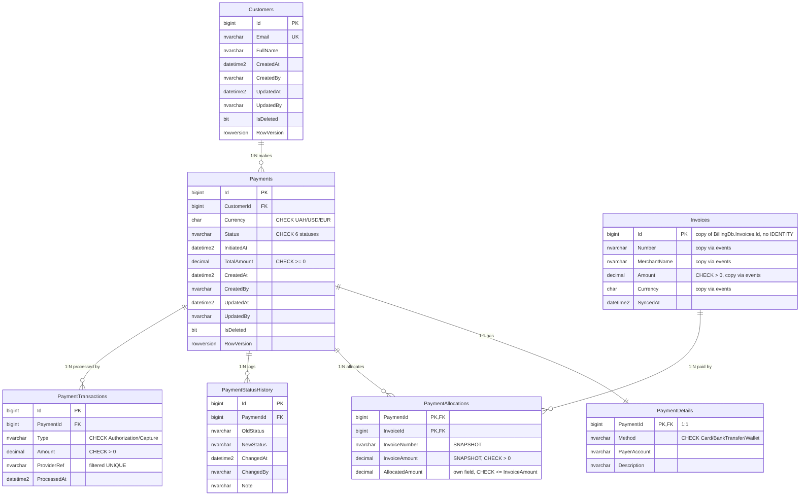
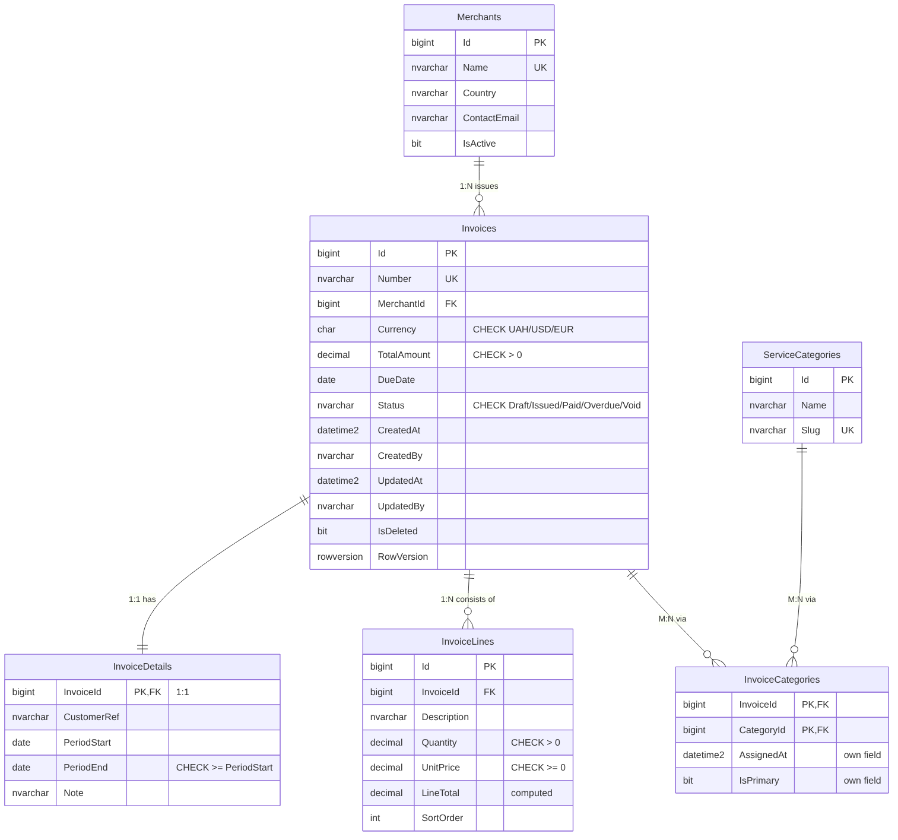

# Лаб. 01 — Проєктування баз даних для мікросервісної архітектури

Домен: **платіжна платформа для оплати рахунків**. Платники сплачують рахунки мерчантів (комунальні послуги, зв'язок, інтернет); мерчанти виставляють рахунки; оператори супроводжують платежі (перевірка, авторизація, списання, розрахунок) і розглядають спори. Система розбита на три автономні сервіси, кожен із власною БД.

## Три контексти (Bounded Contexts)

| # | Контекст | БД | Технологія | Сутності |
|---|---|---|---|---|
| 1 | Платежі | `PaymentsDb` | SQL Server (ADO.NET + Dapper) | Customers, Payments, PaymentDetails, PaymentAllocations, PaymentStatusHistory, PaymentTransactions, Invoices (локальна копія довідника) |
| 2 | Білінг | `BillingDb` | SQL Server (EF Core) | Merchants, ServiceCategories, Invoices, InvoiceDetails, InvoiceLines, InvoiceCategories |
| 3 | Спори | `disputes_db` | MongoDB | disputes, disputeThreads, threadMessages, merchantDisputeStats |

Кожна сутність належить рівно одному контексту. Між базами немає жодного FOREIGN KEY — лише логічні посилання за Id. Деталі: [docs/contexts.md](docs/contexts.md).

## Структура репозиторію

```
README.md
docs/
  contexts.md        опис домену, контексти, агрегати, політика дублювання
  erd-p1.md          ERD Проєкту №1 (Mermaid) + діаграма статусів
  erd-p2.md          ERD Проєкту №2 (Mermaid)
  mongo-examples.md  приклади документів, запити, aggregation
db/
  p1/  schema.sql · procedures.sql · seed.sql · checks.sql
  p2/  schema.sql · seed.sql
  p3/  collections.js · seed.js
```

## Вимоги

SQL Server 2022 (Developer/Express), SSMS (або `sqlcmd`), MongoDB Community Server, `mongosh`. У командах і SSMS замініть `localhost` на назву свого екземпляра SQL Server, якщо він іменований (наприклад, `localhost\MSSQLSERVER01`; для `sqlcmd` тоді замість `-U sa -P ...` можна використати `-E`). Обидві СУБД можна підняти в Docker:

```bash
docker run -e "ACCEPT_EULA=Y" -e "MSSQL_SA_PASSWORD=YourStrong!Passw0rd" -p 1433:1433 -d mcr.microsoft.com/mssql/server:2022-latest
docker run -d -p 27017:27017 --name mongo mongo:7
```

## Розгортання з нуля

Усі скрипти **ідемпотентні**: їх можна запускати повторно, дублікатів не буде. У SSMS кожен файл відкривається й виконується цілком (F5).

### Проєкт №1 — PaymentsDb

1. Виконати `db/p1/schema.sql` (створює БД `PaymentsDb`, таблиці, обмеження та індекси).
2. Виконати `db/p1/procedures.sql` (6 збережуваних процедур).
3. Виконати `db/p1/seed.sql` (платники, довідник рахунків, 4 демо-платежі).
4. За бажанням виконати `db/p1/checks.sql` (запити перевірки).

Через `sqlcmd` (прапорець `-I` обов'язковий: фільтровані індекси вимагають QUOTED_IDENTIFIER ON; у SSMS він увімкнений за замовчуванням):

```bash
sqlcmd -S localhost -U sa -P "YourStrong!Passw0rd" -C -I -i db/p1/schema.sql
sqlcmd -S localhost -U sa -P "YourStrong!Passw0rd" -C -I -i db/p1/procedures.sql
sqlcmd -S localhost -U sa -P "YourStrong!Passw0rd" -C -I -i db/p1/seed.sql
```

### Проєкт №2 — BillingDb

1. Виконати `db/p2/schema.sql` (створює БД `BillingDb`).
2. Виконати `db/p2/seed.sql` (3 мерчанти, 5 категорій, 6 рахунків з деталями, рядками та категоріями).

Id рахунків 1–6 збігаються з `Invoices.Id` у `PaymentsDb` і `invoiceId` у MongoDB.

### Проєкт №3 — MongoDB (`disputes_db`)

```bash
mongosh "mongodb://localhost:27017" db/p3/collections.js
mongosh "mongodb://localhost:27017" db/p3/seed.js
```

`collections.js` створює колекції з JSON Schema валідацією та індексами, `seed.js` додає документи (upsert за фіксованими `_id`).

## Збережувані процедури (Проєкт №1)

| Процедура | Призначення |
|---|---|
| `usp_CreatePayment` | створення платежу + деталі (1:1) + запис історії |
| `usp_AddPaymentAllocation` | додавання розподілу на рахунок; фіксує **знімок** `InvoiceNumber`, `InvoiceAmount`; перераховує суму |
| `usp_GetPaymentWithAllocations` | читання платежу, розподілу, історії, операцій |
| `usp_ChangePaymentStatus` | **транзакційна зміна статусу** з перевіркою допустимого переходу та `RowVersion` |
| `usp_AuthorizePayment` | авторизація: запис операції + перехід у `Authorized` в одній транзакції |
| `usp_SoftDeletePayment` | м'яке видалення (лише `Created`/`Cancelled`) |

Допустимі переходи: `Created → Validating → Authorized → Captured → Settled`; `Cancelled` — лише до списання коштів. Недопустимий перехід завершується керованою помилкою `THROW 50002`.

Приклад:

```sql
EXEC dbo.usp_ChangePaymentStatus @PaymentId = 2, @NewStatus = 'Captured';
-- Msg 50002: Invalid status transition
```

## Ключі, обмеження, індекси

- Ключі: `BIGINT IDENTITY` (одне джерело генерації — БД); у локальній копії `Invoices` (PaymentsDb) Id приходить із Білінгу; у MongoDB — `ObjectId`.
- Обмеження: PK, FK, UNIQUE, CHECK, DEFAULT; каскад лише для частин агрегату (розподіл, деталі, історія, рядки рахунку), не для платників, мерчантів і фінансових операцій.
- Аудит: `CreatedAt/CreatedBy/UpdatedAt/UpdatedBy/IsDeleted` + `RowVersion` (оптимістична конкурентність) для `Customers`, `Payments` (PaymentsDb) та `Invoices` (BillingDb).
- Кожен індекс має коментар із запитом, під який створений (`db/p1/schema.sql`, `db/p2/schema.sql`, `db/p3/collections.js`).

## ERD

- Проєкт №1 (PaymentsDb): [docs/erd-p1.md](docs/erd-p1.md), зображення — [docs/erd-p1.png](docs/erd-p1.png)
- Проєкт №2 (BillingDb): [docs/erd-p2.md](docs/erd-p2.md), зображення — [docs/erd-p2.png](docs/erd-p2.png)





## Політика дублювання даних

| Поле | Де зберігається | Джерело (власник даних) | Політика узгодженості |
|---|---|---|---|
| `PaymentAllocations.InvoiceNumber`, `PaymentAllocations.InvoiceAmount` | PaymentsDb | Invoice (BillingDb) | Знімок на момент створення розподілу — не оновлюється |
| `Invoices.Number`, `MerchantName`, `Amount`, `Currency` (локальна копія довідника) | PaymentsDb | Invoice / Merchant (BillingDb) | Копія для читання, оновлюється подіями з Білінгу |
| `Invoices.Id` / `PaymentAllocations.InvoiceId` | PaymentsDb | Invoice (BillingDb) | Той самий Id, звичайний стовпець без FK на BillingDb |
| `disputes.paymentId` | disputes_db | Payment (PaymentsDb) | Лише ідентифікатор, без FK; перевіряється прикладним кодом |
| `disputes.invoiceId`, `disputes.merchantId` | disputes_db | Invoice / Merchant (BillingDb) | Лише ідентифікатор, без FK |
| `disputes.merchantName`, `merchantDisputeStats.merchantName` | disputes_db | Merchant (BillingDb) | Копія для читання, оновлюється подіями з Білінгу |
| `disputes.amount`, `disputes.currency` | disputes_db | PaymentAllocation (PaymentsDb) | Знімок на момент відкриття спору, не оновлюється |
| `disputes.openedBy.userId`, `openedBy.displayName`, `threadMessages.author.*` | disputes_db | Customer (PaymentsDb) | `userId` — ідентифікатор; `displayName` — знімок на момент публікації |

Кожне дубльоване поле має єдиного власника; споживачі не редагують копії самостійно (немає dual write).

## Самоперевірка перед здачею

1. У `PaymentsDb` і `BillingDb`: `SELECT * FROM sys.foreign_keys;` — усі `referenced` таблиці в межах тієї ж БД.
2. Виклик `usp_ChangePaymentStatus @PaymentId = 2, @NewStatus = 'Captured'` повертає помилку 50002 і не змінює статус.
3. `db.disputes.find()` у `disputes_db` повертає документи з різними наборами полів (`evidence`, `fraudDetails`, `serviceProof`, `tags`).
4. Повторний запуск `seed.sql` / `seed.js` не збільшує кількість рядків і документів.

---

# Лаб. 02 — Мікросервіс Payments: ADO.NET + Dapper, UoW, Generic Repository, Aspire

Тришарова архітектура (вертикальний зріз) для сервісу платежів поверх `PaymentsDb` з Лаб. 01.

```
Platform.slnx
Platform.AppHost/                 .NET Aspire AppHost (AppHost.cs) — запускає API разом з БД
Services/Payments/
  Payments.Domain/                моделі, константи, доменні винятки (NotFound / BusinessConflict / Validation)
  Payments.Dal/                   IGenericRepository<T>, репозиторії (ADO.NET, Dapper), UnitOfWork
  Payments.Bll/                   DTO, профіль AutoMapper, сервіси, реєстрація DI
  Payments.Api/                   контролери, ProblemDetails-обробник, Swagger, Serilog, appsettings
```

Залежності: `Api → Bll → Dal → Domain` (Api також бачить Dal лише для DI-складання).

## Ключові рішення

| Тема | Рішення |
|---|---|
| Generic Repository | `IGenericRepository<T>` (Get/GetAll/Add/Delete) повертає моделі, не `DataReader`. `IInvoiceRepository`, `IPaymentRepository` успадковують його і додають специфічні методи |
| Чистий ADO.NET | `CustomerRepository` — `SqlCommand`, `SqlParameter`, `SqlDataReader`; інтерфейс `ICustomerRepository` **не** успадковує generic |
| Dapper | `BaseDapperRepository<T>` (спільний async-CRUD) → `InvoiceRepository`, `PaymentRepository`; multi-mapping (`Payment + PaymentDetails + PaymentAllocation`, `splitOn`), виклики збережених процедур Лаб. 01 |
| SQL | Усі значення — параметрами; імена таблиць — константи коду; з'єднання/команди/рідери в `using` / `await using` |
| Unit of Work | Одне `SqlConnection` + одна `SqlTransaction` на HTTP-запит (Scoped). `BeginTransactionAsync(IsolationLevel)`, `CommitAsync`, `RollbackAsync` (враховує «зомбі»-транзакцію після `XACT_ABORT`), `DisposeAsync` |
| Транзакційна операція | `PaymentService.CreateAsync`: клієнт → платіж → деталі → розподіл на рахунки (знімок номера й суми рахунку робить `usp_AddPaymentAllocation`). Збій будь-якого кроку відкочує все |
| DTO / AutoMapper | DTO окремо від моделей; `MappingProfile` реєструється централізовано в `Program.cs`, ліцензійний ключ — `AutoMapper:LicenseKey` |
| Валидація | 1-й рівень — DataAnnotations на DTO (→ 400); 2-й — бізнес-правила в BLL (валюта, метод, дублікати рахунків, унікальність e-mail, збіг валют) |
| Помилки | `SqlExceptionTranslator`: 50001/50006/50008 → NotFound; 50002–50014, 2601/2627, 547 → BusinessConflict. `DomainExceptionHandler` (IExceptionHandler + ProblemDetails): 404 / 409 / 400 / 500 |
| Контролери | Тонкі, async, attribute routing, `CancellationToken`, `CreatedAtAction`, Swagger з `ProducesResponseType` |
| Конфігурація | Рядок підключення — `appsettings.json`; перекривається змінною `ConnectionStrings__PaymentsDb` |
| Логування | Serilog (консоль), request logging |

## Запуск через Aspire

Потрібно: .NET SDK 9 (для `.slnx` — 9.0.200+), БД `PaymentsDb` з Лаб. 01 (`db/p1/schema.sql`, `procedures.sql`, `seed.sql`).

1. Перевірте рядок підключення в `Platform.AppHost/appsettings.json` (за замовчуванням `localhost\MSSQLSERVER01`, Windows-автентифікація, `TrustServerCertificate=true`).
2. Збірка: `dotnet build Platform.slnx`
3. Запуск: `dotnet run --project Platform.AppHost` (або F5 у Visual Studio / VS Code на `Platform.AppHost`).
4. Відкрийте Aspire Dashboard за адресою з консолі (`http://localhost:15170`): ресурс `payments-api` має стан **Running**. У ньому ж видно посилання на API.
5. Swagger: `http://localhost:5080/swagger` (порт API також видно в дашборді).

Без Aspire: `dotnet run --project Services/Payments/Payments.Api` (Swagger на `http://localhost:5080/swagger`).

Інший сервер БД без правки файлів:
`set ConnectionStrings__PaymentsDb=Server=...;Database=PaymentsDb;...` (PowerShell: `$env:ConnectionStrings__PaymentsDb="..."`).

Ліцензійний ключ AutoMapper 15 (за наявності): `dotnet user-secrets set "AutoMapper:LicenseKey" "<key>" --project Services/Payments/Payments.Api` або змінна `AutoMapper__LicenseKey`.

## Приклади запитів (curl)

```bash
BASE=http://localhost:5080

# платники
curl $BASE/api/customers
curl $BASE/api/customers/1
curl -X POST $BASE/api/customers -H "Content-Type: application/json" \
  -d '{"email":"connor.obrien@example.com","fullName":"Connor O'"'"'Brien"}'

# рахунки (копія довідника Білінгу)
curl $BASE/api/invoices
curl -X POST $BASE/api/invoices -H "Content-Type: application/json" \
  -d '{"id":100,"number":"INV-2026-0100","merchantName":"Test Merchant","amount":500.00,"currency":"UAH"}'

# створити платіж з розподілом на вільні рахунки 6 (seed) і 100 (щойно створений) — одна транзакція
curl -X POST $BASE/api/payments -H "Content-Type: application/json" \
  -d '{"customerId":1,"currency":"UAH","method":"Card","payerAccount":"4111-XXXX-XXXX-1111",
       "description":"Оплата","allocations":[{"invoiceId":6},{"invoiceId":100}]}'

curl $BASE/api/payments/5
curl "$BASE/api/customers/1/payments?page=1&pageSize=10"

# життєвий цикл: Created -> Validating -> Authorized
curl -X POST $BASE/api/payments/5/status -H "Content-Type: application/json" -d '{"newStatus":"Validating"}'
curl -X POST $BASE/api/payments/5/authorize -H "Content-Type: application/json" -d '{"amount":800.00,"providerRef":"AUTH-1"}'
curl -X POST $BASE/api/payments/5/status -H "Content-Type: application/json" -d '{"newStatus":"Authorized"}'

# помилки
curl -i $BASE/api/payments/999999                                            # 404 ProblemDetails
curl -i -X POST $BASE/api/payments/2/status -H "Content-Type: application/json" -d '{"newStatus":"Settled"}'  # 409 (недопустимий перехід)
curl -i -X POST $BASE/api/customers -H "Content-Type: application/json" -d '{"email":"bad","fullName":""}'      # 400 (DataAnnotations)
curl -i -X DELETE $BASE/api/payments/2                                       # 204 (платіж у статусі Created)
```

> Id у прикладах відповідають seed-даним Лаб. 01 (рахунки 1–5 уже розподілені, вільний — 6; перший новий платіж отримає Id 5). Якщо Id інші — підставте свої. Розподіл рахунку, що вже оплачується, поверне 409.

## Самоперевірка (Лаб. 02)

- [ ] `dotnet build Platform.slnx` без помилок
- [ ] `POST /api/customers` з прізвищем `O'Brien` — створюється без помилки SQL (параметри)
- [ ] `POST /api/payments` з неіснуючим `invoiceId` → 404, і **жоден** платіж не збережено (відкат)
- [ ] Повторний недопустимий перехід статусу → 409
- [ ] Невідомий Id → 404; некоректне тіло → 400; відкат транзакції при штучному збої
- [ ] Aspire Dashboard: `payments-api` у стані Running; Swagger відкривається

---

# Лаб. 03 — Мікросервіс Billing на EF Core (Code First)

Другий мікросервіс платформи: контекст «Білінг» (Проєкт №2 з Лаб. 01). На відміну від Payments (ADO.NET + Dapper), доступ до даних тут побудований на **EF Core**: моделі, Fluent API, міграції, LINQ to Entities.

```
Services/Billing/
  Billing.Domain/   сутності з інкапсульованими правилами, доменні винятки
  Billing.Dal/      BillingDbContext, Configurations/, Migrations/, репозиторії, Unit of Work, Specifications/, Seeding/
  Billing.Bll/      сервіси, DTO, профіль AutoMapper, FluentValidation-валідатори
  Billing.Api/      контролери, Program.cs, ProblemDetails-обробник, Serilog, Swagger, Dockerfile
```

## Модель (Code First)

| Зв'язок | Реалізація |
|---|---|
| 1:N | `Merchant → Invoice` (Restrict: мерчант з рахунками не видаляється), `Invoice → InvoiceLine` (Cascade) |
| 1:1 | `Invoice ↔ InvoiceDetail` (PK = FK) |
| M:N | `Invoice ↔ ServiceCategory` через явну сутність `InvoiceCategory` (складений ключ, власні поля `AssignedAt`, `IsPrimary`; унікальний фільтрований індекс «одна основна категорія») |

Бізнес-правила — у сутності `Invoice` (приватні setter-и, валідація в конструкторі; методи `AddLine`, `Issue`, `MarkPaid`, `Void`, `Reschedule`, `AssignCategory`, `MarkDeleted`). Також: `decimal(18,2)`, CHECK-обмеження, унікальні індекси, `rowversion`, м'яке видалення (global query filter), обчислюваний стовпець `LineTotal`.
Кожна сутність має окремий `IEntityTypeConfiguration<T>`; усі підключаються в `OnModelCreating` через `ApplyConfigurationsFromAssembly`.

## Репозиторії, Unit of Work, специфікації

- `GenericRepository<T>` на `DbSet<T>`: `GetByIdAsync`, `GetAllAsync`, `AddAsync`, `Update`, `Delete` + `ListAsync/CountAsync(spec)`. Репозиторії самі не зберігають — лише `UnitOfWork.SaveChangesAsync()` (один виклик наприкінці операції, одна транзакція).
- **Eager Loading** — `InvoiceRepository.GetWithDetailsAsync` (`Include/ThenInclude`, один запит).
- **Explicit Loading** — `MerchantRepository.GetWithInvoicesAsync` (`Entry(...).Collection(...).Query().LoadAsync`, два запити).
- **LINQ M:N** — `InvoiceCategoryRepository.GetRecentlyAssignedAsync` (через проміжну сутність і `AssignedAt`).
- **Specification pattern** (Ardalis.Specification): `InvoicesFilterSpec`, `InvoicesPageSpec`, `OverdueInvoicesSpec`; репозиторій застосовує будь-яку через `WithSpecification(spec)`.

## API

| Метод | Шлях | Результат |
|---|---|---|
| GET | `/api/invoices?page=&pageSize=&search=&status=&merchantId=&minAmount=&maxAmount=&sortBy=number\|amount\|dueDate&sortDir=` | 200, `PagedResult` |
| GET | `/api/invoices/{id}` | 200 / 404 (Eager) |
| GET | `/api/invoices/overdue` | 200 (друга специфікація) |
| GET | `/api/categories/{slug}/invoices?since=` | 200 (M:N) |
| POST | `/api/invoices` | 201 + Location / 400 / 404 / 409 |
| POST | `/api/invoices/{id}/pay`, `/void`, `/categories`; PUT `/due-date` | 200 / 404 / 409 |
| DELETE | `/api/invoices/{id}` | 204 (лише Draft/Void) |
| GET/POST | `/api/merchants`, GET `/api/merchants/{id}` | Explicit Loading |

Формат пагінації: тіло `{ items, totalCount, page, pageSize, totalPages, hasNext, hasPrevious }` + заголовки `X-Total-Count`, `X-Total-Pages`. `pageSize` за замовчуванням 20, максимум 100. Фільтрація, сортування (лише дозволені поля) і `Skip/Take` виконуються в SQL.

Помилки (ProblemDetails): `EntityNotFoundException` → 404, `ValidationException` → 400, `ConflictException`/`DomainException` → 409, решта → 500 (деталі лише в Development). Валідація: DataAnnotations на DTO + FluentValidation (явний виклик у контролері → `ValidationProblemDetails`).

## Запуск і міграції

Потрібно: .NET SDK 9, SQL Server, `dotnet tool install --global dotnet-ef`.
БД створюється **з моделей** міграцією; за замовчуванням це **нова база `BillingEfDb`** (щоб не конфліктувати з `BillingDb`, створеною скриптом `db/p2/schema.sql`). Рядок підключення — `Services/Billing/Billing.Api/appsettings.json` або змінна `ConnectionStrings__BillingDb`.

```bash
# міграція вже є в репозиторії; застосувати вручну (необов'язково — API робить Migrate при старті):
dotnet ef database update --project Services/Billing/Billing.Dal --startup-project Services/Billing/Billing.Api --environment Development

# згенерувати SQL-скрипт міграції
dotnet ef migrations script --idempotent --project Services/Billing/Billing.Dal --startup-project Services/Billing/Billing.Api -o db/p2/billing-ef-migration.sql

# (за потреби) перестворити початкову міграцію «з нуля»
#   видаліть папку Services/Billing/Billing.Dal/Migrations, потім:
dotnet ef migrations add InitialCreate --project Services/Billing/Billing.Dal --startup-project Services/Billing/Billing.Api
```

Запуск: `dotnet run --project Services/Billing/Billing.Api` → Swagger `http://localhost:5090/swagger`, або `dotnet run --project Platform.AppHost` (ресурс `billing-api` поруч з `payments-api`). Docker: `docker build -f Services/Billing/Billing.Api/Dockerfile -t billing-api .`

**Сідінг** ідемпотентний: довідники (мерчанти, категорії) — `HasData` у конфігураціях; рахунки, рядки, деталі, категорії — `DbInitializer` після `MigrateAsync()` з перевіркою наявності (вимикається в Production або `Database:Seed=false`). Дані збігаються з `db/p2/seed.sql`.

**Логи SQL.** Serilog виводить команди EF Core (`Microsoft.EntityFrameworkCore.Database.Command`): `GET /api/invoices/1` — один SELECT з JOIN (Eager); `GET /api/merchants/1` — два SELECT (Explicit).

## Приклади

```bash
BASE=http://localhost:5090
curl "$BASE/api/invoices?page=2&pageSize=2&sortBy=amount&sortDir=desc"
curl "$BASE/api/invoices?status=Issued&minAmount=300"
curl $BASE/api/invoices/1
curl $BASE/api/merchants/1
curl "$BASE/api/categories/utilities/invoices?since=2020-01-01"
curl $BASE/api/invoices/overdue

curl -X POST $BASE/api/invoices -H "Content-Type: application/json" -d '{
  "number":"INV-2026-0100","merchantId":1,"currency":"UAH","dueDate":"2026-12-20",
  "customerRef":"ACC-100234","lines":[{"description":"Електроенергія","quantity":100,"unitPrice":4.8}]}'
# повторити той самий запит -> 409 (дубль номера)

curl -i -X POST $BASE/api/invoices -H "Content-Type: application/json" -d '{"number":"","merchantId":1,"lines":[]}'  # 400 з переліком полів
curl -i $BASE/api/invoices/999999                                                                                    # 404 ProblemDetails
curl -i -X POST $BASE/api/invoices/1/void                                                                            # 409 (Paid не анулюється)
```

## Самоперевірка (Лаб. 03)

- [ ] `dotnet build Platform.slnx` без помилок; міграція застосовується до порожньої БД
- [ ] `GET /api/invoices?page=2&pageSize=5` повертає `totalCount` усіх записів, а не сторінки
- [ ] POST з порожнім `number` → 400 з полями; повторний номер → 409; неіснуючий Id → 404
- [ ] Повторний запуск застосунку не дублює seed-дані
- [ ] У лозі SQL: Eager — 1 запит, Explicit — 2
- [ ] `/api/invoices/overdue` працює через ту саму `ListAsync(spec)` без змін у репозиторії
