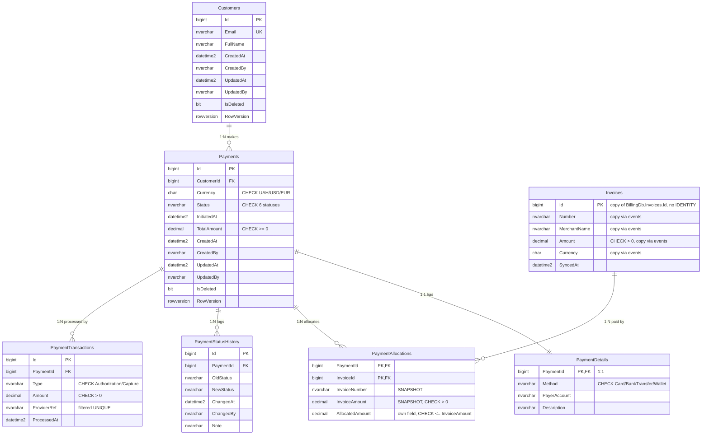
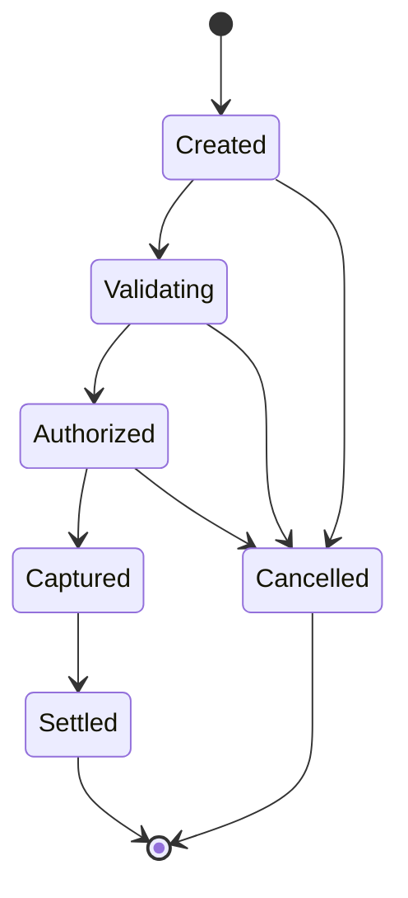

# ERD — Проєкт №1 (PaymentsDb)

Діаграма Mermaid (відображається на GitHub і в VS Code з розширенням Mermaid). Для здачі зображенням: відкрийте у [mermaid.live](https://mermaid.live), експортуйте PNG/SVG у `docs/` або відтворіть у draw.io.

## Типи зв'язків

| Зв'язок | Тип | Де FK |
|---|---|---|
| Customers → Payments | 1:N | `Payments.CustomerId` |
| Payments ↔ PaymentDetails | 1:1 | `PaymentDetails.PaymentId` (є також PK) |
| Payments ↔ Invoices | M:N | проміжна `PaymentAllocations` (PK `PaymentId, InvoiceId`, власне поле `AllocatedAmount`) |
| Payments → PaymentStatusHistory | 1:N | `PaymentStatusHistory.PaymentId` |
| Payments → PaymentTransactions | 1:N | `PaymentTransactions.PaymentId` |

`InvoiceId` у `PaymentAllocations`/`Invoices` — логічне посилання на Білінг: FK веде лише на **локальну** `dbo.Invoices`, а не на BillingDb.

## Діаграма переходів статусів

