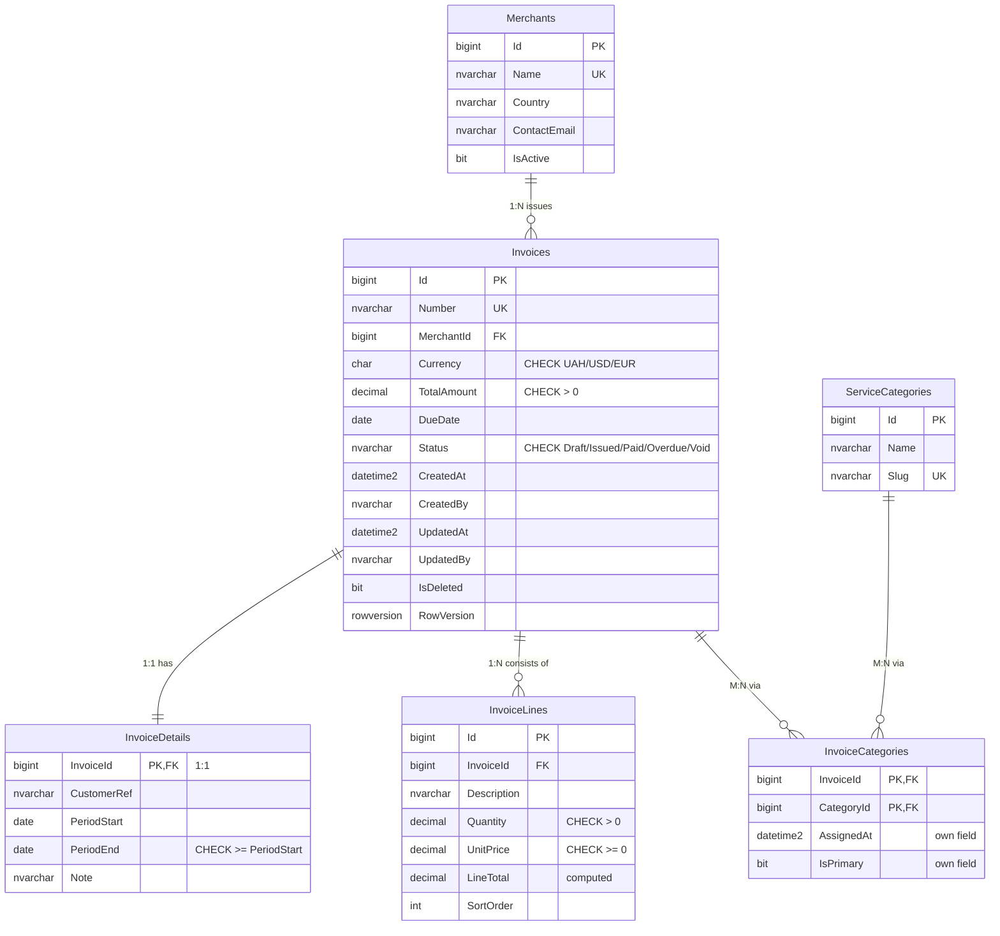

# ERD — Проєкт №2 (BillingDb)

Діаграма Mermaid (GitHub / VS Code). Для здачі зображенням: експорт з [mermaid.live](https://mermaid.live) у PNG/SVG у `docs/` або відтворення в draw.io.

## Типи зв'язків

| Зв'язок | Тип | Де FK |
|---|---|---|
| Merchants → Invoices | 1:N | `Invoices.MerchantId` |
| Invoices ↔ InvoiceDetails | 1:1 | `InvoiceDetails.InvoiceId` (є також PK) |
| Invoices → InvoiceLines | 1:N | `InvoiceLines.InvoiceId` |
| Invoices ↔ ServiceCategories | M:N | проміжна `InvoiceCategories` (PK `InvoiceId, CategoryId`, власні поля `AssignedAt`, `IsPrimary`) |

## Унікальність, перевірки, індекси

- UNIQUE: `Merchants.Name`, `ServiceCategories.Slug`, `Invoices.Number`; відфільтрований унікальний індекс `UX_IC_Primary` (не більше однієї основної категорії на рахунок).
- CHECK: `TotalAmount > 0`, `Quantity > 0`, `UnitPrice >= 0`, `Currency IN (UAH, USD, EUR)`, `Status IN (...)`, `PeriodEnd >= PeriodStart`.
- Індекси під запити — у коментарях `db/p2/schema.sql`.
- Міграції: схема готова до Code First (Лаб. 03): сутності й Fluent API відтворюють цей DDL, а зміни проходять через `dotnet ef migrations`.
